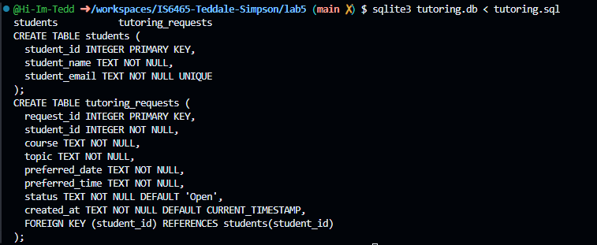
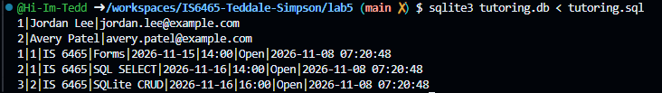
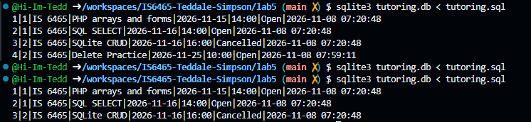

Part 1

1. 

2. In the students table, the primary key is the student id. In the tutoring request table the primary key is the request id.

3. The student id is the foreign key. It represents the link between the students table and the tutoring request table to know which student makes which request.

4. student_email is marked as unique so that we do not have more than one student with the same email.

Part 2

1. INSERT OR ignore INTO students (student_name, student_email)
VALUES ('Jordan Lee', 'jordan.lee@example.com');

INSERT OR ignore INTO students (student_name, student_email)
VALUES ('Avery Patel', 'avery.patel@example.com');

INSERT OR ignore INTO tutoring_requests
  (student_id, course, topic, preferred_date, preferred_time)
VALUES
  (1, 'IS 6465', 'Forms', '2026-11-15', '14:00'),
  (1, 'IS 6465', 'SQL SELECT', '2026-11-16', '14:00'),
  (2, 'IS 6465', 'SQLite CRUD', '2026-11-16', '16:00');

2. 

3. Jordan has one student row because there is only one Jordan Lee student. He has to tutoring requests entered and they are linked to him by his student ID (foreign key) of 1.

Part 3

SELECT
  r.request_id,
  s.student_name,
  s.student_email,
  r.course, r.topic,
  r.preferred_date, r.preferred_time, r.status
FROM tutoring_requests AS r
JOIN students AS s ON r.student_id = s.student_id
ORDER BY r.preferred_date;

1|Jordan Lee|jordan.lee@example.com|IS 6465|Forms|2026-11-15|14:00|Open
2|Jordan Lee|jordan.lee@example.com|IS 6465|SQL SELECT|2026-11-16|14:00|Open
3|Avery Patel|avery.patel@example.com|IS 6465|SQLite CRUD|2026-11-16|16:00|Open

1. The JOIN condition connects to students table with the tutoring_requests table

2. The JOIN command conntects two tables where as the WHERE command specifies specific search criteria

3. The request ID is unique per request where as multiple requests can have the same topic

Part 4

1. UPDATE tutoring_requests
SET topic = 'PHP arrays and forms',
WHERE request_id = 1;

UPDATE tutoring_requests
SET status = 'Cancelled',
WHERE request_id = 3;

2. BEFORE
1|1|IS 6465|Forms|2026-11-15|14:00|Open|2026-11-08 07:20:48
2|1|IS 6465|SQL SELECT|2026-11-16|14:00|Open|2026-11-08 07:20:48
3|2|IS 6465|SQLite CRUD|2026-11-16|16:00|Open|2026-11-08 07:20:48

AFTER

1|1|IS 6465|PHP arrays and forms|2026-11-15|14:00|Open|2026-11-08 07:20:48
2|1|IS 6465|SQL SELECT|2026-11-16|14:00|Open|2026-11-08 07:20:48
3|2|IS 6465|SQLite CRUD|2026-11-16|16:00|Open|2026-11-08 07:20:48

3. 1|1|IS 6465|PHP arrays and forms|2026-11-15|14:00|Open|2026-11-08 07:20:48
2|1|IS 6465|SQL SELECT|2026-11-16|14:00|Open|2026-11-08 07:20:48
3|2|IS 6465|SQLite CRUD|2026-11-16|16:00|Cancelled|2026-11-08 07:20:48

4. The WHERE specifies where in the table the change should occur instead of updating all rows

5. The Peer Tutoring Hub uses a Cancelled status so that requests can be terminated but still reserve the actual request data

Part 5

1. INSERT OR ignore INTO tutoring_requests
  (student_id, course, topic, preferred_date, preferred_time)
VALUES
  (2, 'IS 6465', 'Delete Practice', '2026-11-25', '10:00');

2. DELETE from tutoring_requests
WHERE request_id = 4;

3. 

4. The WHERE clause helps us target the delete action and delete only the specified row. This stops us from deleting the entire row

Part 6

| CRUD action | SQL statement used in this lab | Peer Tutoring Hub example |
|---|---|---|
| Create | `INSERT INTO` / `INSERT OR IGNORE INTO` | Add a student or tutoring request, such as a request for IS 6465 SQL help |
| Read | `SELECT ... FROM ... JOIN ... ORDER BY ...` | Retrieve tutoring requests with the associated student details |
| Update | `UPDATE ... SET ... WHERE ...` | Change a request topic or mark its status as Cancelled |
| Delete | `DELETE FROM ... WHERE ...` | Remove a specific tutoring request by its request ID |

1. By using the student ID as a foreign key in the tutoring_request table to link both tables

2. The restraint UNIQUE

3. The change would affect all rows in the table

4. It helps separate user input from SQL commands which reduces the risk of SQL injection
