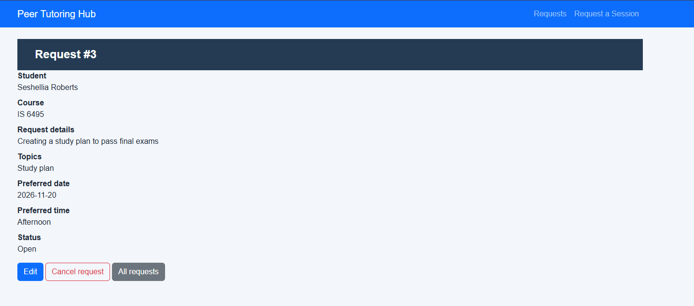

# Lab 6 Notes

## Part 1

The command used to verify both tables appeared was .tables in the SQLite prompt.

## Part 2

1. URL opened in browser - https://super-rotary-phone-g5xr6j5pxr73vp4v-8000.app.github.dev/php/request-form.php

2. The request was processed without errors and a confirmation was displayed with my request number and the information about my request

3. 

## Part 3

| Test | What I Did | Expected Result | Actual Result | Pass or Fail |
|---|---|---|---|---|
| Submit a valid request | Submitted a valid request without errors | A new tutoring request is created with status Open | New request was created with status Open | Pass |
| View all requests | Clicked the All Requests button | The new request appears in the request table | List of all results was presented | Pass |
| Filter requests | Filtered requests by status | Filtering by course or status shows matching requests | Filter correctly showed all Opened requests and all cancelled requests | Pass |
| Edit an Open request | Clicked the Edit button and edited a request | The revised values are displayed | Changes made were displayed correctly | Pass |
| Cancel an Open request | Clicked Cancel Request request | The request status changes to Cancelled | Request state changed to Cancelled | Pass |
| Try to edit or cancel a cancelled request | Went into cancelled request to edit | The application does not allow the change | There is no option to edit a cancelled request | Pass |

## Part 4

1. request-form.php

2. process-request.php

3. db.php

4. requestService.php

5. requestPDO.php, studentPDO.php

6. students

7. tutoring_requests

8. They connect through the use of foreign keys

## Part 5

PASS UC01 create and Open
PASS Lab 4 checkbox values preserved
FAIL Duplicate email reuses student
FAIL UC02 course and status filter
PASS Invalid reason rejected
FAIL Invalid submission writes nothing
PASS Edit Open request
PASS Updated reason persisted
PASS Cancel Open request
PASS Cancelled row retained
PASS Second cancellation rejected
PASS Unrelated request unchanged
PASS FK enforced
PASS UC02 empty filter result
FAILURES: 3

## Part 6

| Requirement | Application Page | Service or Validation | Repository or SQL | Database Table | Test Evidence |
|---|---|---|---|---|---|
| Student submits a tutoring request. | request-form.php collects the request and posts to process-request.php, which invokes the service and redirects on success. | requestService.php alidates the submission and wraps saving in a transaction; validation.php checks the selected topics, preferred time, and reason. | studentPDO.php inserts or finds a student by email; requestPDO.php inserts the request using a prepared statement. setup-database.sql defines the schema and the default `Open` status. | students stores the student ID, name, and unique email. tutoring_requests stores request details and references students.student_id; status defaults to `Open`. | integration-tests.php `UC01 create and Open` and `Lab 4 checkbox values preserved` pass. The full script currently reports three count-based failures because the setup SQL seeds a student and request. |

Test Harness Generator

1. The test is not covered by integation-tests.php. Reject an invalid student email without writing to the database. 

2. Submit a request with an invalid email (for example, student@) and otherwise valid fields. Expect a validation error and verify that neither students nor tutoring_requests gained a row.

3. The AI generated test would be appropriate for this application in helping to prevent students from using fake email addresses.

## Part 7

The JOIN allows us to combine rows from both tables into a single result by using the related student_id column
